# Sri KP Fitness Center — Gym Management System

<div align="center">

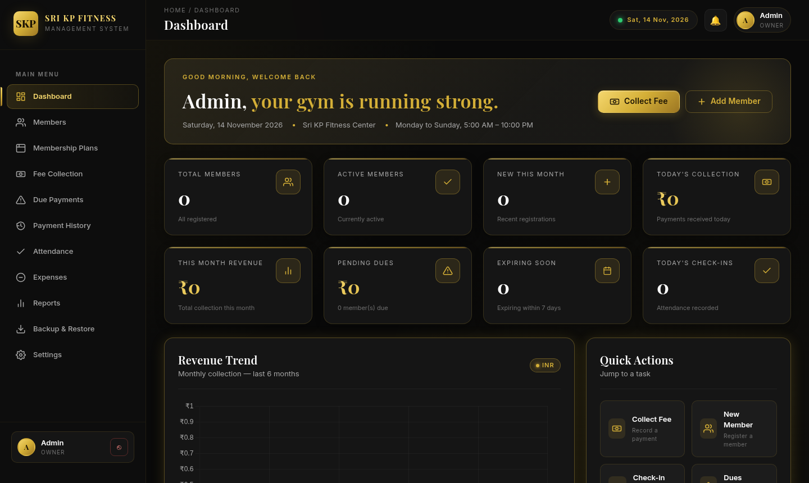

**A premium Black & Gold gym management app — fully offline, local-first, deployable in one click.**

[](https://poontamilzhan.github.io/KP-Fitness-Centre/)
[]()
[]()

</div>

---

## About

**Sri KP Fitness Center** management system — built for the gym at:

| Field | Details |
|---|---|
| **Name** | Sri KP Fitness Center |
| **Address** | Mathampalayam, Puliampatti, Erode – 638459, Tamil Nadu |
| **Phone** | +91 99622 59269 |
| **Hours** | Monday to Sunday, 5:00 AM – 10:00 PM |

All data is stored **locally in your browser** (IndexedDB). Nothing leaves your device unless you enable Google Drive sync.

---

## Screenshots

### 1. Login Page
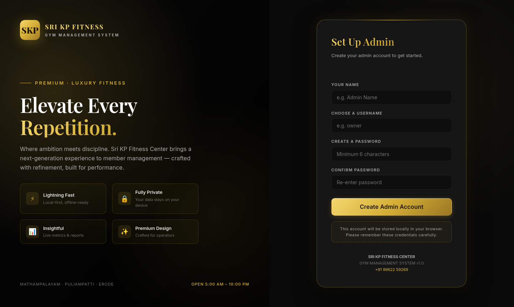

Secure admin login with PBKDF2-SHA256 password hashing. First launch auto-shows the account setup form. Forgot password recovery wipes only the admin login — member data is preserved.

---

### 2. Dashboard


Live summary of your gym at a glance:
- **Active Members** — count of members with valid membership
- **Today's Collection** — money received today
- **Monthly Revenue** — total this month
- **Pending Dues** — total outstanding balance
- **Expiring Soon** — members whose membership expires within 7 days
- **Today's Attendance** — check-ins today
- Revenue trend chart (last 6 months) + attendance bar chart (last 7 days)
- Quick-action buttons: Add Member, Collect Fee, Check In, Add Expense
- Expiring-soon member list with days remaining

---

### 3. Member Management
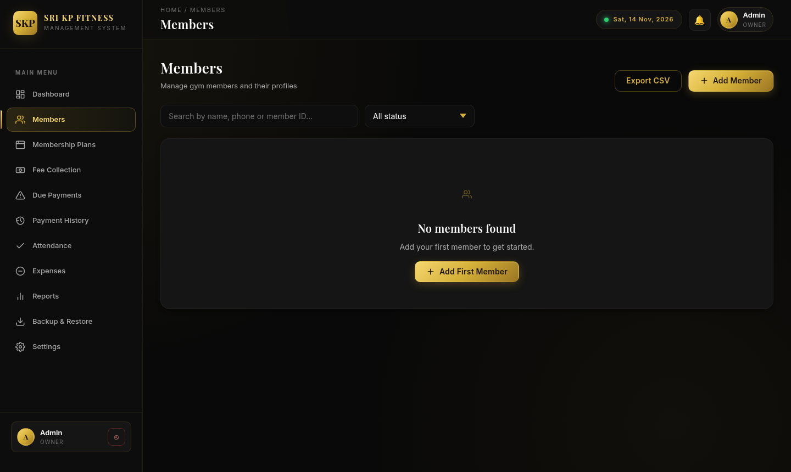

Full member directory with:
- Search by name, phone, or member code
- Filter by status (Active / Expired / Overdue / Upcoming)
- Paginated table (10 per page)
- Status badges with color coding
- CSV export of the filtered list
- Quick links to member profile and fee collection

---

### 4. Add / Edit Member
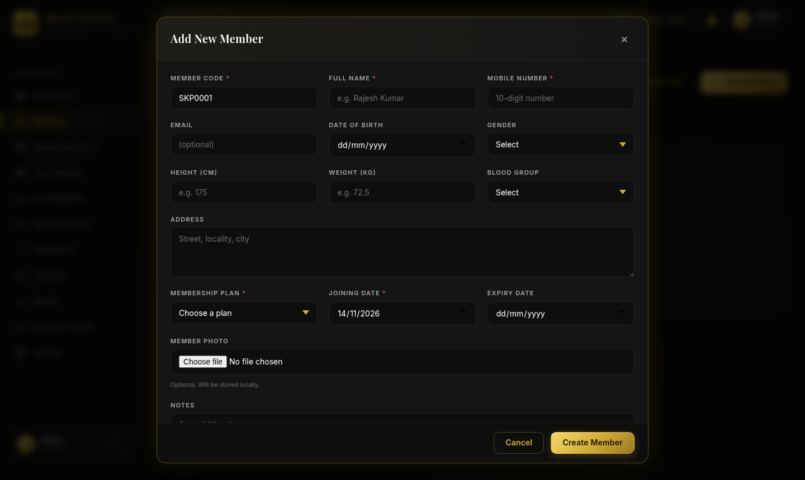

Comprehensive member form covering:
- **Personal:** Name, Phone, Email, Date of Birth, Blood Group
- **Body Stats:** Height (cm), Weight (kg) — BMI auto-calculated on profile
- **Membership:** Plan, Joining Date, Expiry Date
- **Photo:** Base64 image preview (optional)
- Auto-generated Member Code (SKP0001, SKP0002 …)

---

### 5. Fee Collection
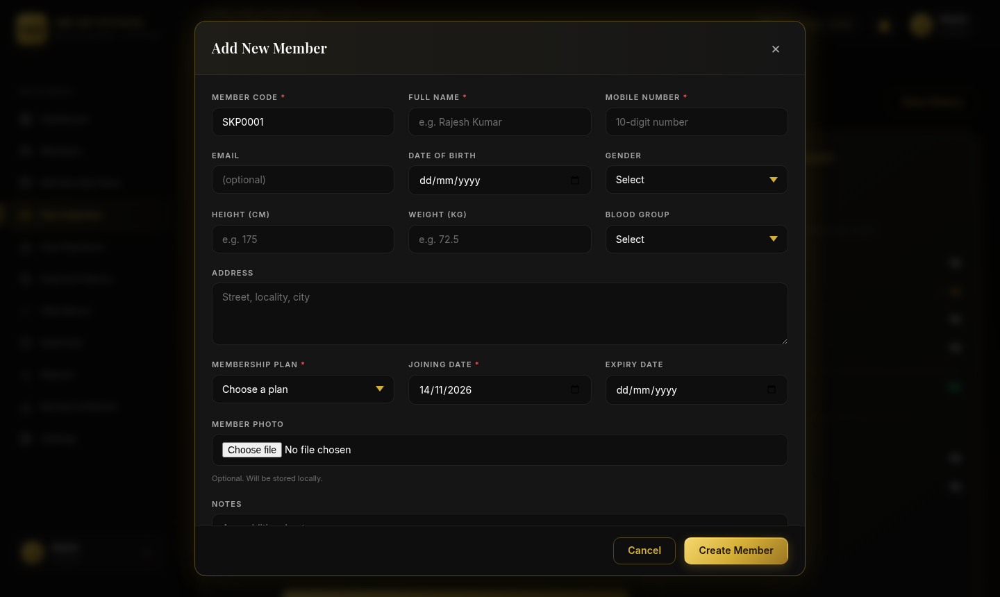

Each payment is a **fully independent transaction** — no confusing billing cycles:
- Select member → see their entire payment history instantly
- Choose plan (optional — can override fee manually)
- Enter: Total Fee, Discount, **Amount Received**, Valid From/Till, Payment Method, Remarks
- **Live summary panel** shows:
  - Net Bill = Fee − Discount
  - This Transaction Balance = Net Bill − Amount Received
  - Previously Paid (all prior payments)
  - Total Paid After This Payment
- Soft warnings: discount > fee, received = 0, partial payment
- Auto-extends member expiry if validTill > current expiry
- Instant receipt generated and printable in luxury black/gold or plain white print

---

### 6. Due Payments
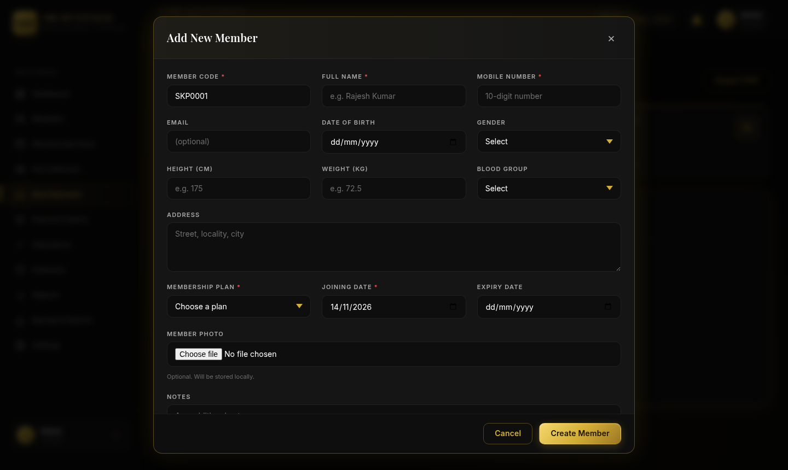

One-screen view of every member with an outstanding balance:
- Sorted by most overdue first
- Shows: member photo/initials, code, phone, due date, balance amount, days overdue badge
- **Collect** button jumps directly to fee collection for that member
- Summary cards: Total Pending amount, Overdue count, Due Members count
- Export all dues to CSV

---

### 7. Payment History


Complete audit trail of all payments:
- Filter by date range (from / to)
- Search by member name or receipt number
- Shows: Receipt No, Member, Plan, Net Bill, Received, Balance, Method, Date
- **Reprint** any receipt without re-entering data
- Export filtered results to CSV

---

### 8. Attendance
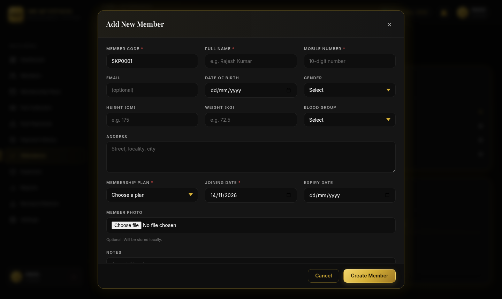

Quick check-in system:
- Live clock (seconds precision)
- Search member by name or code → one-click check-in
- Duplicate prevention — same member can't check in twice per day
- Today's check-in log table
- Weekly and monthly attendance stats

---

### 9. Membership Plans
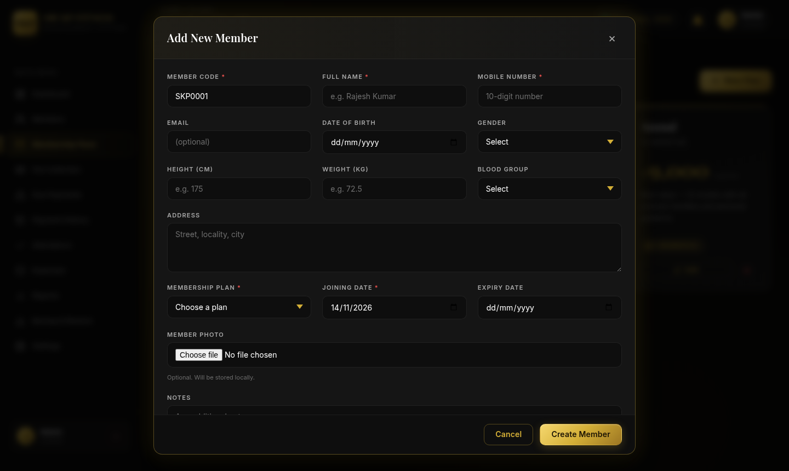

Manage pricing tiers:
- Default plans seeded: Monthly ₹1000, Quarterly ₹2700, Half-Yearly ₹5000, Annual ₹9000
- Add / Edit / Delete plans
- Usage count per plan — delete blocked if any members are assigned
- Duration in months drives auto expiry calculation in fee collection

---

### 10. Expenses
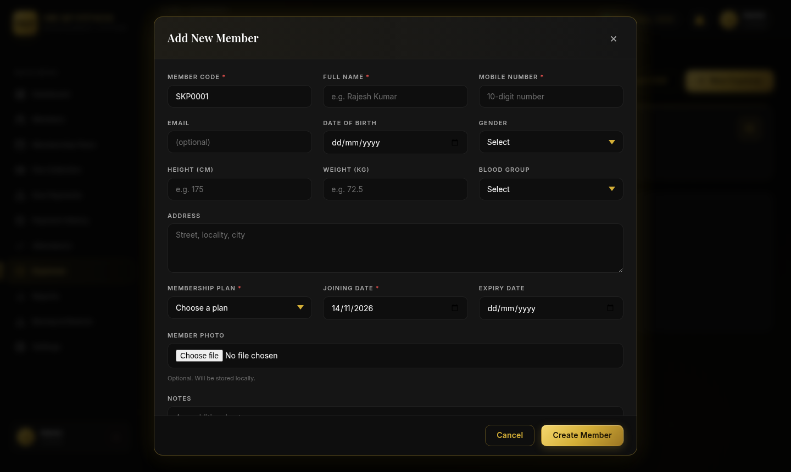

Track gym running costs:
- Categories: Rent, Electricity, Equipment, Maintenance, Salary, Other
- Month / Year filter
- Total by category breakdown
- All-time total and this-month total metric cards
- CSV export

---

### 11. Reports
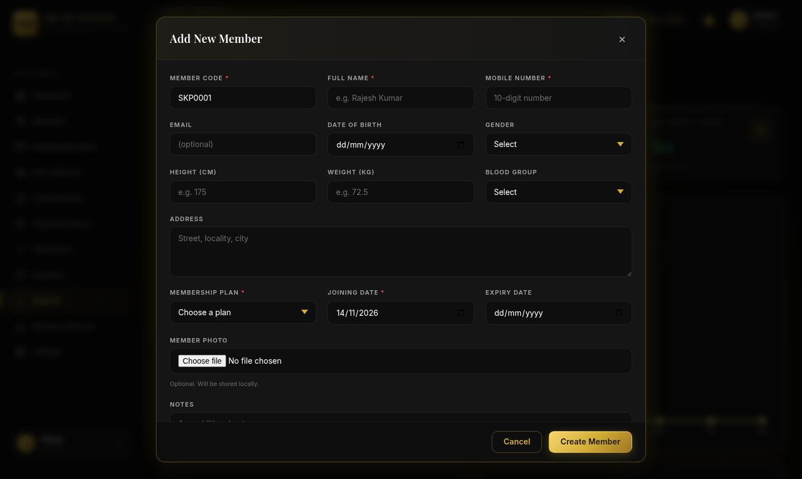

8 detailed report modals + 4 Chart.js visualisations:
- **Revenue vs Expenses** bar chart (last 6 months)
- **Member Growth** line chart
- **Expense Category** doughnut
- **Plan Distribution** doughnut
- Report modals: Daily Summary, Monthly Summary, Pending Dues, Member List, Expiry Report, Expense Report, P&L Statement, Attendance Report

---

### 12. Backup & Restore
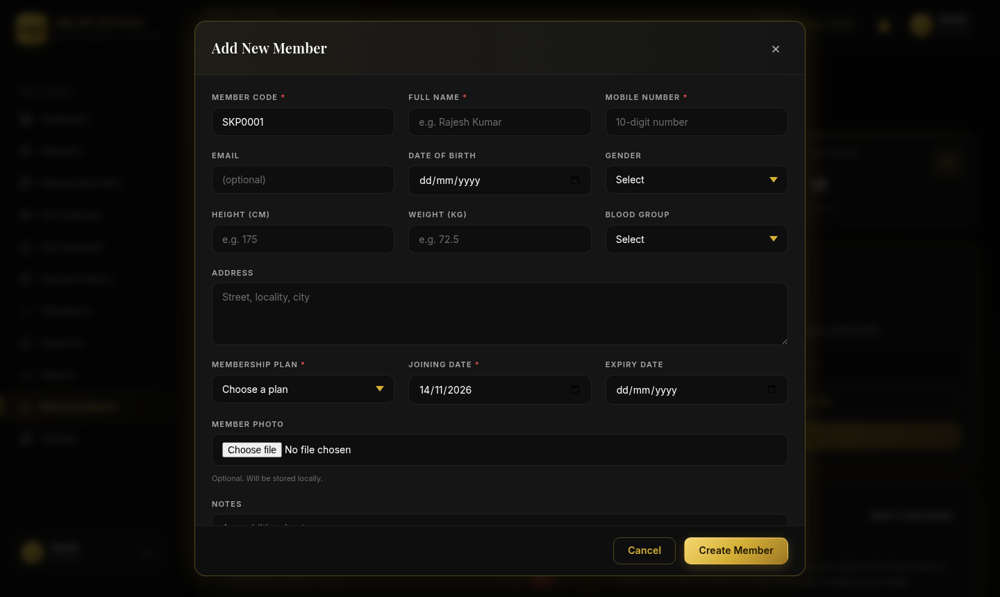

Three-layer data safety system:

| Layer | Interval | Storage |
|---|---|---|
| **Auto Snapshots** | Every 2 min | Browser IndexedDB (last 3 kept) |
| **Google Drive Sync** | Every 2 min | Your private Drive app folder |
| **Manual Export** | On demand | JSON file download |

- Download any auto-snapshot or trigger manual export
- Restore from a JSON file (admin login preserved)
- Restore directly from Google Drive backup
- Google Drive setup guide built into the panel

---

### 13. Settings
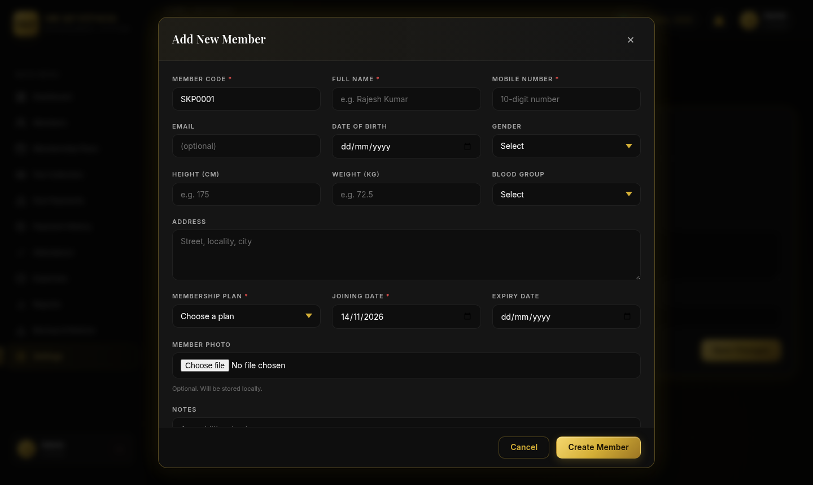

Four tabs:
- **General** — Gym name, address, phone, operating hours
- **Branding** — Color palette preview (Black & Gold design system)
- **Admin Account** — Change password with current-password verification
- **Danger Zone** — Clear all data (keep admin) or Full reset

---

## Completed Features

| # | Feature | Status |
|---|---|---|
| 1 | PBKDF2-SHA256 local admin authentication | ✅ |
| 2 | First-time setup flow + forgot password recovery | ✅ |
| 3 | Dashboard with 8 metric cards + 2 live charts | ✅ |
| 4 | Member CRUD with photo, body stats, blood group | ✅ |
| 5 | Auto member code generation (SKP0001…) | ✅ |
| 6 | Member status engine (Active / Expired / Overdue / Upcoming) | ✅ |
| 7 | BMI auto-calculation on member profile | ✅ |
| 8 | Membership plans with per-plan usage tracking | ✅ |
| 9 | Independent-transaction fee collection (Option B model) | ✅ |
| 10 | Live fee summary with Net Bill / Balance / Lifetime totals | ✅ |
| 11 | Auto receipt generation with luxury print stylesheet | ✅ |
| 12 | Member expiry auto-extension on payment | ✅ |
| 13 | Due payments list sorted by most overdue | ✅ |
| 14 | Full payment history with date-range filter | ✅ |
| 15 | Receipt reprint from history | ✅ |
| 16 | Attendance check-in with duplicate guard | ✅ |
| 17 | Expense tracking by category | ✅ |
| 18 | 8 report types + 4 Chart.js visualisations | ✅ |
| 19 | CSV export on Members, Dues, History, Expenses | ✅ |
| 20 | Auto local snapshot every 2 min (IndexedDB) | ✅ |
| 21 | Google Drive cloud sync every 2 min | ✅ |
| 22 | Manual JSON backup export + restore | ✅ |
| 23 | Restore directly from Google Drive | ✅ |
| 24 | Notifications panel (expiring + dues alerts) | ✅ |
| 25 | Hash-based client-side routing | ✅ |
| 26 | PWA manifest (installable as desktop/mobile app) | ✅ |
| 27 | Fully responsive — desktop, tablet, mobile | ✅ |
| 28 | Black & Gold premium design system | ✅ |
| 29 | Settings — gym info, password change, danger zone | ✅ |
| 30 | Vercel + GitHub Pages deployment config | ✅ |

---

## Future Ideas / Roadmap

### 🔔 Smart Alerts
- WhatsApp message template generator for dues reminders
- Browser push notifications for expiring memberships
- Daily morning summary notification

### 📊 Advanced Analytics
- Member retention rate chart
- Revenue forecasting based on renewal trends
- Peak hour attendance heatmap (hour × day grid)
- Plan popularity trend over time

### 👥 Multi-Admin Support
- Role-based access: Owner / Manager / Staff
- Staff can only do check-in and fee collection
- Audit log: who changed what and when

### 💪 Fitness Tracking
- Workout plans assigned per member
- Body measurement history (weight, BMI trend chart)
- Personal trainer assignment
- Goal setting and progress tracking

### 📱 PWA Enhancements
- Full offline support via Service Worker caching
- Background sync when internet returns
- Home screen install prompt
- Native share for receipts

### 💳 Payment Integrations
- Razorpay / PhonePe QR code display on receipt
- UPI deep-link generation for dues collection
- Digital payment confirmation logging

### 📸 Photo & ID
- Member ID card generator (printable)
- QR code per member for quick attendance scan
- Bulk photo import

### 🔄 Data Sync
- Multi-device sync via Firebase Realtime Database
- Offline-first with conflict resolution
- Export to Google Sheets (live sync)
- Automatic Google Drive versioned history (keep last 30 days)

### 🧾 Advanced Receipts
- PDF receipt download (via browser print-to-PDF)
- Email receipt via mailto: link
- WhatsApp share receipt image

### 📆 Scheduling
- Batch renewal reminders (send SMS template)
- Class / session scheduling module
- Holiday / closure calendar

---

## Tech Stack

| Layer | Technology |
|---|---|
| **UI** | Vanilla HTML5 + CSS3 + JavaScript (ES2020) |
| **Storage** | IndexedDB (via custom DB wrapper) |
| **Auth** | Web Crypto API — PBKDF2-SHA256, 50k iterations |
| **Charts** | Chart.js 4.x (CDN) |
| **Fonts** | Playfair Display · Inter · JetBrains Mono (Google Fonts) |
| **Cloud Sync** | Google Drive API v3 + Google Identity Services |
| **Deployment** | GitHub Pages · Vercel |
| **Build** | None — zero build step, zero dependencies |

---

## File Structure

```
KP-Fitness-Centre/
├── index.html              # Login + first-time setup page
├── app.html                # App shell (sidebar, header, outlet)
├── manifest.json           # PWA manifest (installable)
├── vercel.json             # Vercel deployment config
│
├── css/
│   ├── variables.css       # Design tokens (colors, spacing, fonts)
│   ├── base.css            # Reset, body, toast, spinner, animations
│   ├── components.css      # Buttons, cards, tables, modals, badges
│   ├── login.css           # Split-screen login layout
│   ├── layout.css          # Sidebar + header + main grid
│   ├── pages.css           # Page-specific styles
│   ├── receipt.css         # Luxury digital + print receipt styles
│   └── responsive.css      # Mobile / tablet breakpoints
│
├── js/
│   ├── config.js           # App config (name, DB version, prefixes)
│   ├── db.js               # IndexedDB wrapper (8 stores)
│   ├── auth.js             # PBKDF2 auth, session, password change
│   ├── utils.js            # Money, dates, DOM helpers, toast, modal
│   ├── store.js            # Business logic (members, dues, metrics)
│   ├── backup.js           # Export, restore, local auto-snapshots
│   ├── gdrive.js           # Google Drive OAuth2 + sync
│   ├── router.js           # Hash-based SPA router
│   ├── app.js              # Bootstrap, nav, notifications, routes
│   └── pages/
│       ├── dashboard.js    # Dashboard metrics + charts
│       ├── members.js      # Member list + profile + form
│       ├── plans.js        # Plan CRUD
│       ├── fees.js         # Fee collection + receipt
│       ├── dues.js         # Pending dues list
│       ├── history.js      # Payment history
│       ├── attendance.js   # Check-in + log
│       ├── expenses.js     # Expense tracking
│       ├── reports.js      # 8 reports + charts
│       ├── backup-page.js  # Backup UI + Drive panel
│       └── settings.js     # Settings tabs
│
└── assets/
    └── screenshots/        # README screenshots
```

---

## Running Locally

```bash
# Clone the repo
git clone https://github.com/POONTAMILZHAN/KP-Fitness-Centre.git
cd KP-Fitness-Centre

# Start any static server (pick one)
python3 -m http.server 5500
# OR
npx serve .
# OR
php -S localhost:5500
```

Open **http://localhost:5500** — first load shows the admin setup form.

> **Note:** Opening `index.html` via `file://` may work but a local server is recommended for IndexedDB reliability.

---

## First-Time Setup

1. Open the app — the **Create Admin Account** form appears automatically
2. Enter your Name, Username, and Password (min 6 chars)
3. Default plans are seeded: Monthly ₹1000 · Quarterly ₹2700 · Half-Yearly ₹5000 · Annual ₹9000
4. Edit plans from **Membership Plans** to match your gym's pricing
5. Update gym info from **Settings → General**

---

## Google Drive Sync Setup

To enable automatic cloud backup every 2 minutes:

1. Go to **[console.cloud.google.com](https://console.cloud.google.com/)**
2. Create a project → **APIs & Services** → Enable **Google Drive API**
3. **OAuth consent screen** → External → add your Gmail as test user
4. **Credentials** → Create **OAuth 2.0 Client ID** → Web application
5. Add Authorized JavaScript origins: `http://localhost:5500` (dev) + your live URL
6. Copy the **Client ID**
7. In the app → **Backup & Restore** → Google Drive Sync → paste Client ID → **Save & Connect**
8. Sign in with Google — auto-sync starts immediately

Your backup is stored in a **private app folder** in your Google Drive — not visible in the main Drive view, only accessible by this app.

---

## Deploying to GitHub Pages

```bash
# Push to GitHub
git remote add origin https://github.com/POONTAMILZHAN/KP-Fitness-Centre.git
git push -u origin main

# Then in GitHub:
# Settings → Pages → Source: main branch / (root) → Save
# Live URL: https://poontamilzhan.github.io/KP-Fitness-Centre/
```

## Deploying to Vercel

```bash
npm install -g vercel
vercel
# OR: Import the GitHub repo at vercel.com (zero config needed)
```

---

## Data Safety

| Threat | Protection |
|---|---|
| Browser data cleared | Google Drive sync + manual export |
| Device lost/stolen | Google Drive cloud copy |
| Accidental data delete | Local snapshots (last 3, every 2 min) |
| Admin password forgotten | Recovery wipe (member data preserved) |
| Corruption | JSON restore from any snapshot |

**Best practice:** Enable Drive sync + download a manual backup weekly.

---

## Browser Support

| Browser | Support |
|---|---|
| Chrome / Edge 90+ | ✅ Full |
| Firefox 90+ | ✅ Full |
| Safari 15+ | ✅ Full |
| Mobile Chrome / Safari | ✅ Full |

Requires: **IndexedDB** + **Web Crypto API** — available in all modern browsers since 2017.

---

## Design System

```
Colors:    #D4AF37 Gold  ·  #090909 Black  ·  #151515 Card
Fonts:     Playfair Display (headings)  ·  Inter (body)  ·  JetBrains Mono (numbers)
Spacing:   4 / 8 / 12 / 16 / 20 / 24 / 32 / 40 / 48 px scale
Tokens:    All in css/variables.css
```

---

<div align="center">

**Crafted with discipline and refinement for Sri KP Fitness Center**

*Mathampalayam, Puliampatti, Erode – 638459, Tamil Nadu*

</div>
